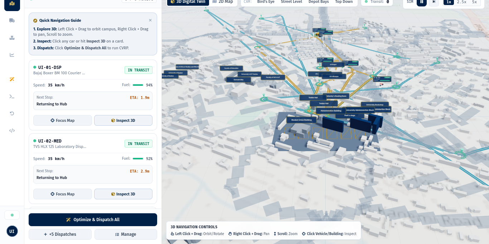
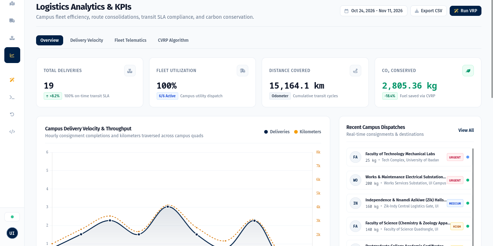
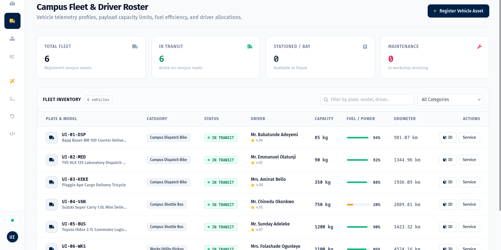
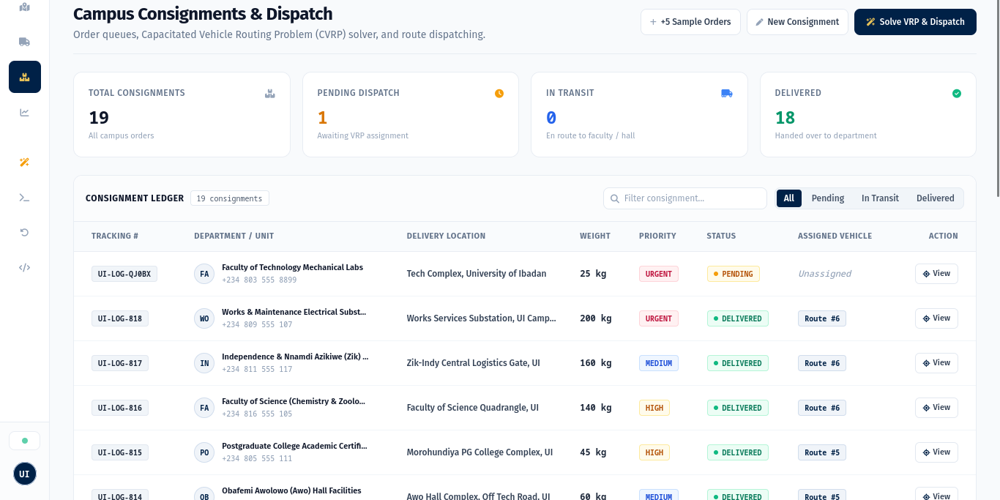
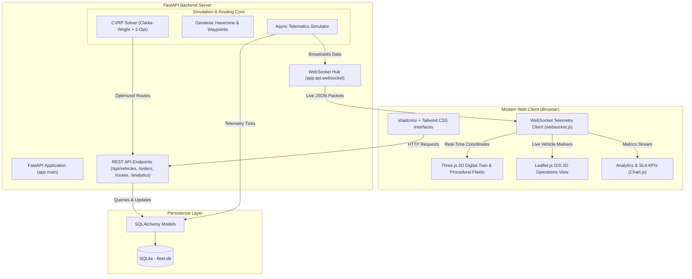

<div align="center">
  
  <br/><br/>
  <h1>UI-FleetFlow</h1>
  <p><b>Intelligent Campus Fleet & Logistics Management System</b><br/>
  <i>Academic Case Study: University of Ibadan (UI), Ibadan, Nigeria</i><br/>
  Real-Time 3D Digital Twin • Autonomous CVRP Dispatch Solver • High-Frequency Telematics</p>

  <p>
    <a href="https://university-of-ibadan-fleet-management.onrender.com/" target="_blank">
      
    </a>
  </p>

  <p>
    <a href="https://university-of-ibadan-fleet-management.onrender.com/"></a>
    <a href="https://www.python.org/"></a>
    <a href="https://fastapi.tiangolo.com"></a>
    <a href="https://threejs.org/"></a>
    <a href="https://ui.shadcn.com/"></a>
    <a href="https://www.sqlite.org/"></a>
    <a href="LICENSE"></a>
    
  </p>

  <p>
    <a href="#-user-interface-showcase">Showcase</a> •
    <a href="#-project-overview">Project Overview</a> •
    <a href="#-case-study-campus-landmarks">Campus Landmarks</a> •
    <a href="#-logistics--optimization-engine-vrp">VRP Heuristics</a> •
    <a href="#-system-architecture">Architecture</a> •
    <a href="#-quick-start-guide">Quickstart</a> •
    <a href="#-live-interactive-platform">Live Links</a>
  </p>
</div>

---

> [!NOTE]
> **Academic Project Note**: UI-FleetFlow is an independent student academic school project modeling campus-scale urban logistics and telematics. It is not an officially affiliated platform of the University of Ibadan administration; all campus facilities and landmarks are studied as an empirical case study for logistics optimization.

---

## 📸 User Interface Showcase

> [!TIP]
> Click any screenshot below to open that exact live view in your browser.

| View | Live UI Preview (Click to Launch) |
|---|---|
| **Live 3D Digital Twin Viewport**<br>• Real OpenStreetMap Satellite & Street Layouts<br>• Flat Dynamic Highway Navigation Ribbons<br>• Authentic Campus Fleet (Bajaj, TVS, Piaggio, Carry, HiAce)<br>• Live Telematics Sidebar Drawer<br><br>[**▶ Launch Interactive 3D Twin**](https://university-of-ibadan-fleet-management.onrender.com/) | [](https://university-of-ibadan-fleet-management.onrender.com/) |
| **Analytics & SLA KPIs Dashboard**<br>• Authentic shadcn/ui Dashboard block<br>• 4-card metric block (Deliveries, Fleet Utilization, Odometer, CO₂ Conserved)<br>• Campus Delivery Velocity & Throughput Area Chart<br>• Real-time dispatches stream<br><br>[**▶ Open Live Analytics**](https://university-of-ibadan-fleet-management.onrender.com/analytics) | [](https://university-of-ibadan-fleet-management.onrender.com/analytics) |
| **Fleet & Drivers Management Roster**<br>• Authentic shadcn/ui Data Table block<br>• Monospace plate tags, battery/fuel progress bars, driver ratings<br>• Real-time asset filtering & modal registration<br><br>[**▶ Open Live Fleet Roster**](https://university-of-ibadan-fleet-management.onrender.com/vehicles) | [](https://university-of-ibadan-fleet-management.onrender.com/vehicles) |
| **Campus Consignments & Orders Ledger**<br>• Capacitated Vehicle Routing Problem (CVRP) queue<br>• Priority badges (Urgent, High, Medium, Low)<br>• Consignment ledger with 1-click batch solver<br><br>[**▶ Open Live Orders Desk**](https://university-of-ibadan-fleet-management.onrender.com/orders) | [](https://university-of-ibadan-fleet-management.onrender.com/orders) |

---

## 📌 Project Overview

**UI-FleetFlow** was developed as a school project exploring computational logistics and real-time telematics. It models multi-vehicle parcel distribution and shuttle routing across a university campus, using the **University of Ibadan (UI)**—Nigeria's premier university—as a practical real-world case study.

The platform addresses common university and institutional logistics scenarios:
1. **Inter-Faculty Consignments & Material Logistics**: Document, parcel, and examination logistics between academic departments, libraries, and administrative units.
2. **Medical & Laboratory Logistics**: Cold-chain specimen and supply routing connecting the University Health Services (Jaja Clinic), Faculty of Pharmacy, and the College of Medicine / UCH axis.
3. **Campus Facilities & Maintenance Fleet**: Dispatching utility pickups, trucks, and courier bikes with load and capacity constraints.
4. **Real-Time GPS Tracking**: Simulated high-frequency vehicle telemetry broadcast over WebSockets to an interactive Leaflet.js operations dashboard.

---

## 🗺️ Case Study Campus Landmarks

The simulation incorporates real geographic coordinates across the University of Ibadan campus to test routing heuristics against real distances:

| Campus Location / Landmark | Case Study Role | Latitude | Longitude |
|---|---|---|---|
| **Central Campus Logistics Depot** | Central Hub / Start & End Depot | `7.445210` | `3.899015` |
| **Kenneth Dike Library (KDL)** | Archival & Book Delivery | `7.447800` | `3.900800` |
| **Tekena Tamuno Senate Building** | Administration & Registry | `7.448500` | `3.899800` |
| **Trenchard Hall** | Examinations & Events Desk | `7.448200` | `3.900100` |
| **Faculty of Technology** | Engineering Laboratories | `7.452000` | `3.898500` |
| **Faculty of Science** | Physical & Chemical Stores | `7.449500` | `3.902000` |
| **Jaja Clinic** | Health Services Delivery | `7.446200` | `3.897000` |
| **College of Medicine Complex** | Medical Liaison | `7.447000` | `3.901500` |
| **Faculty of Pharmacy** | Research & Pharmacology Labs | `7.449000` | `3.903500` |
| **Postgraduate College** | Academic Records & Transcripts | `7.450500` | `3.896000` |
| **International Conference Centre (ICC)** | Second Gate Facilities Hub | `7.456000` | `3.892000` |
| **UI Ventures (Commercial Area)** | University Commercial Stores | `7.443500` | `3.902500` |
| **Teaching & Research Farm** | Agricultural Produce Transit | `7.444500` | `3.905500` |
| **Zik & Independence Halls** | Student Residential Logistics | `7.454500` | `3.895500` |

---

## 🧠 Logistics & Optimization Engine (VRP)

The solver models the **Capacitated Vehicle Routing Problem (CVRP)**:

### 1. Clarke-Wright Savings Heuristic
Given a central logistics depot $D$ and delivery points $i, j$:
- Combines separate round-trips into consolidated vehicle tours based on travel savings:
  
  $$S_{ij} = d(D, i) + d(D, j) - d(i, j)$$

- Merges stops sequentially while respecting each vehicle's maximum payload capacity:
  
  $$\sum_{i \in \text{Tour}_k} w_i \le Q_k$$

### 2. 2-Opt TSP Local Search
- Iteratively tests edge-exchange operations on each route to eliminate crossing segments and minimize total travel distance:
  
  $$\text{Route}' = R[1 \dots i-1] + R[i \dots j]^{-1} + R[j+1 \dots n]$$

---

## 🏗️ System Architecture



---

## 🚀 Quick Start Guide

### 1. Prerequisites
- Python 3.10+
- Git

### 2. Setup

```bash
# Clone the repository
git clone <YOUR_REPO_URL>
cd <YOUR_REPO_FOLDER>

# Create and activate a virtual environment
python3 -m venv venv
source venv/bin/activate       # On Windows: venv\Scripts\activate

# Install dependencies
pip install -r requirements.txt
```

### 3. Run the Application

```bash
python run.py
```

The database (`fleet.db`) will automatically initialize with sample case study data.

### 🌐 Live Interactive Platform

Experience the full live operational deployment directly in your browser:
- 🚀 **Live 3D Operations Dashboard**: [university-of-ibadan-fleet-management.onrender.com](https://university-of-ibadan-fleet-management.onrender.com/)
- 🚚 **Campus Fleet & Drivers Roster**: [university-of-ibadan-fleet-management.onrender.com/vehicles](https://university-of-ibadan-fleet-management.onrender.com/vehicles)
- 📦 **Campus Consignments & Orders Ledger**: [university-of-ibadan-fleet-management.onrender.com/orders](https://university-of-ibadan-fleet-management.onrender.com/orders)
- 📊 **Logistics Analytics & KPIs**: [university-of-ibadan-fleet-management.onrender.com/analytics](https://university-of-ibadan-fleet-management.onrender.com/analytics)
- 📖 **Interactive API Documentation (Docs)**: [university-of-ibadan-fleet-management.onrender.com/docs](https://university-of-ibadan-fleet-management.onrender.com/docs)
- 📑 **ReDoc API Specifications**: [university-of-ibadan-fleet-management.onrender.com/redoc](https://university-of-ibadan-fleet-management.onrender.com/redoc)

---

### 💻 Local Development Links

When running locally, open your browser to:
- **Operations Dashboard**: [http://localhost:8000](http://localhost:8000) (or [http://127.0.0.1:8000](http://127.0.0.1:8000))
- **Fleet & Drivers Registry**: [http://localhost:8000/vehicles](http://localhost:8000/vehicles)
- **Logistics Dispatch Desk**: [http://localhost:8000/orders](http://localhost:8000/orders)
- **Analytics & SLA KPIs**: [http://localhost:8000/analytics](http://localhost:8000/analytics)
- **Interactive API Documentation (Docs)**: [http://localhost:8000/docs](http://localhost:8000/docs)
- **ReDoc Specification**: [http://localhost:8000/redoc](http://localhost:8000/redoc)

---

## 🧪 Testing

The automated test suite validates routing optimization, geodesic formulas, and API endpoints:

```bash
source venv/bin/activate
pytest -v
```

All 12 unit and integration tests will execute.

---

## 📄 Open-Source License

This project is licensed under the [MIT License](LICENSE) — free and open for educational, academic, and research use.
