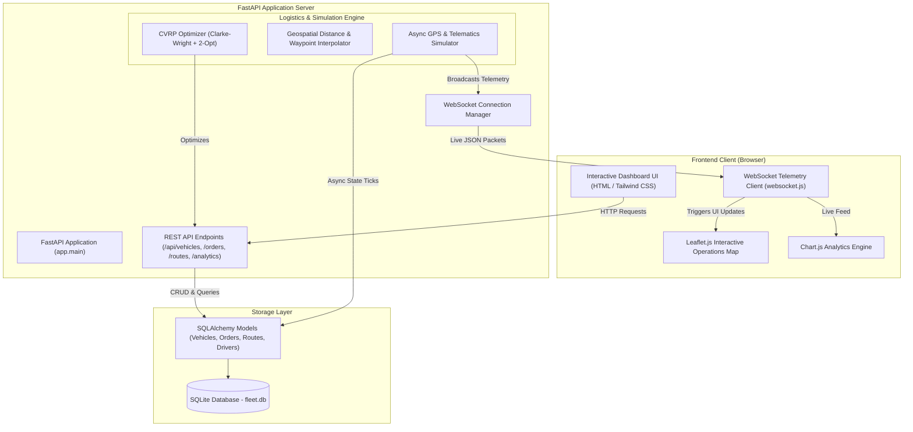

# 🚚 FleetFlow — Intelligent Fleet Management & Real-Time Logistics Optimization System

[](https://fastapi.tiangolo.com)
[](https://www.python.org/)
[](https://www.sqlite.org/)
[](https://leafletjs.com/)
[]()
[](LICENSE)

A production-grade, full-stack fleet management and delivery logistics platform built with **FastAPI**, **SQLAlchemy**, **SQLite**, **Leaflet.js**, and an algorithmic **Vehicle Routing Problem (VRP)** optimization engine with real-time GPS telemetry streaming over **WebSockets**.

Designed for commercial delivery fleets, last-mile logistics dispatchers, and urban freight operators.

---

## 📌 Table of Contents

- [Core Features](#-core-features)
- [System Architecture](#-system-architecture)
- [Logistics Optimization Engine (VRP)](#-logistics-optimization-engine-vrp)
- [Real-Time Telematics & Simulation](#-real-time-telematics--simulation)
- [Project Structure](#-project-structure)
- [Getting Started](#-getting-started)
- [API Reference](#-api-reference)
- [Testing](#-testing)
- [Submitting to GitHub](#-submitting-to-github)

---

## 🌟 Core Features

- **🗺️ Live Telematics & Interactive Operations Map**:
  - Real-time GPS vehicle tracking rendered with dark CartoDB vector tiles on **Leaflet.js**.
  - Directional vehicle pins rotate with real compass bearing heading.
  - Interactive customer stop pins that dynamically transition from pending/in-transit to delivered.
  - Visual polyline overlays for each vehicle's optimized tour path.

- **⚡ Algorithmic Fleet Optimization (CVRP)**:
  - **Clarke-Wright Savings Heuristic** groups orders into efficient clusters respecting vehicle payload capacities.
  - **2-Opt Local Search Heuristic** eliminates path self-intersections and minimizes travel distance/time.
  - One-click fleet auto-dispatch: automatically pairs pending shipments with available vehicles.

- **📡 Real-Time WebSockets Engine**:
  - Live bi-directional telemetry broadcast channel (`/ws/telemetry`).
  - Streams high-frequency speed, remaining battery/fuel percentage, GPS coordinates, ETA, and drop-off geofence events.
  - Live simulation control deck: Play, Pause, Single-Step, and Speed multipliers (1x, 2.5x, 5x).

- **🚛 Fleet & Driver Inventory**:
  - Comprehensive management of vehicle assets (Electric Vans, Cargo Trucks, Urban Cargo E-Bikes, Hybrid Vans).
  - Driver licensing records, assignment, and performance rating monitoring.
  - One-click maintenance status toggle.

- **📊 Logistics Analytics & Environmental Impact**:
  - Real-time KPI monitors: Fleet Utilization Rate, On-Time Delivery SLA compliance, Total Fleet Distance, and Estimated CO₂ emissions avoided.
  - Priority distribution and battery level telemetry charts powered by **Chart.js**.

- **🌱 Turnkey Seed Data**:
  - Ready out of the box with the San Francisco Metro Central Logistics Hub, 5 diverse fleet vehicles, 5 professional drivers, and 16 realistic urban delivery orders across the city.
  - Instant "Reset Demo" button for presentations and grading demonstrations.

---

## 🏗️ System Architecture



---

## 🧠 Logistics Optimization Engine (VRP)

The platform addresses the **Capacitated Vehicle Routing Problem (CVRP)** with heterogeneous delivery assets:

### 1. Clarke-Wright Savings Heuristic
Given a central logistics depot $D$ and customer delivery orders $i, j \in V$:
- Initially, each customer $i$ is serviced via an individual round-trip tour: $D \to i \to D$.
- The savings $S_{ij}$ obtained by combining customers $i$ and $j$ into a consolidated single tour is:

$$S_{ij} = d(D, i) + d(D, j) - d(i, j)$$

Pairs with the highest savings are sequentially joined, subject to vehicle cargo payload constraints:

$$\sum_{i \in R_k} w_i \le Q_k$$

where $w_i$ is parcel weight and $Q_k$ is vehicle maximum capacity.

### 2. 2-Opt Local Search Heuristic
To eliminate path intersections in each route tour, the algorithm executes 2-opt edge-exchange operations:

$$\text{Route}' = R[1 \dots i-1] + R[i \dots j]^{-1} + R[j+1 \dots n]$$

Iterating until no two-edge swap yields a shorter total path, guaranteeing an efficient travel sequence.

---

## 📡 Real-Time Telematics & Simulation

- **Geodesic Navigation**: Distances and headings are calculated using great-circle Haversine formulas:

$$a = \sin^2\left(\frac{\Delta\phi}{2}\right) + \cos\phi_1 \cos\phi_2 \sin^2\left(\frac{\Delta\lambda}{2}\right)$$

$$d = 2 R \cdot \operatorname{atan2}\left(\sqrt{a}, \sqrt{1-a}\right)$$

- **Street Waypoint Interpolator**: Synthesizes realistic urban turn waypoints between delivery coordinates to simulate real-world street navigation.
- **Geofence Drop-off Triggers**: When a vehicle passes within 70 meters of a destination stop, the shipment is automatically marked as `DELIVERED`, triggering real-time notification toasts and updating SLA metrics.

---

## 📁 Project Structure

```
fleet_management/
├── run.py                 # One-click application launcher
├── requirements.txt       # Python dependencies
├── pytest.ini             # Pytest test configuration
├── .gitignore             # Git ignore file
├── README.md              # Project documentation & guide
├── app/
│   ├── __init__.py
│   ├── main.py            # FastAPI app setup, routes, static mount & WebSockets
│   ├── config.py          # Application configuration settings
│   ├── database.py        # SQLAlchemy engine, session maker & Base
│   ├── models.py          # ORM data models (Vehicle, Driver, Order, Depot, Route)
│   ├── schemas.py         # Pydantic validation schemas
│   ├── seed.py            # Turnkey demo seeder (SF Depot, 5 vehicles, 16 orders)
│   ├── engine/
│   │   ├── __init__.py
│   │   ├── distance.py    # Haversine distance, bearing & waypoint interpolation
│   │   ├── router.py      # Clarke-Wright CVRP + 2-Opt TSP optimization solver
│   │   └── simulator.py   # Background async GPS simulation & telematics broadcaster
│   ├── api/
│   │   ├── __init__.py
│   │   ├── vehicles.py    # Vehicle CRUD & maintenance controls
│   │   ├── orders.py      # Order CRUD & sample batch generator
│   │   ├── routes.py      # Optimization & dispatch endpoints
│   │   ├── analytics.py   # Fleet KPIs, simulation deck & reset handler
│   │   └── websocket.py   # WebSocket connection pool manager
│   ├── static/
│   │   ├── css/
│   │   │   └── style.css  # Dark map styles, marker rotations & animations
│   │   └── js/
│   │       ├── websocket.js   # Live telemetry stream listener
│   │       ├── map.js         # Leaflet map rendering & vehicle pins
│   │       └── dashboard.js   # UI interactions & simulation controls
│   └── templates/
│       ├── base.html      # Responsive dark-theme base layout
│       ├── index.html     # Live Operations Map & Telematics HUD
│       ├── vehicles.html  # Fleet inventory & driver roster
│       ├── orders.html    # Order queue & VRP dispatch controller
│       └── analytics.html # KPI analytics & mathematical report
└── tests/
    ├── test_distance.py   # Haversine & waypoint tests
    ├── test_router.py     # VRP solver & capacity constraints tests
    └── test_api.py        # FastAPI endpoints & dispatch tests
```

---

## 🚀 Getting Started

### 1. Prerequisites
- Python 3.10 or higher
- Git

### 2. Installation

```bash
# Clone the repository
git clone <YOUR_GITHUB_REPO_URL>
cd fleet_management

# Create and activate a virtual environment
python3 -m venv venv
source venv/bin/activate       # On Windows: venv\Scripts\activate

# Install dependencies
pip install -r requirements.txt
```

### 3. Launch the Application

```bash
python run.py
```

The database (`fleet.db`) will be automatically created and populated with demo data on first launch.

Open your browser and navigate to:
- **Web Dashboard**: [http://localhost:8000](http://localhost:8000)
- **Interactive Swagger Docs**: [http://localhost:8000/docs](http://localhost:8000/docs)
- **ReDoc API Reference**: [http://localhost:8000/redoc](http://localhost:8000/redoc)

---

## 🧪 Testing

To run the automated test suite with full coverage:

```bash
source venv/bin/activate
pytest -v
```

All 12 unit and integration tests will execute, validating the routing solver, geodesic formulas, and API endpoints.

---

## 📑 API Reference

| Method | Endpoint | Description |
|---|---|---|
| `GET` | `/api/vehicles` | List all fleet vehicles with driver info |
| `POST` | `/api/vehicles` | Register a new vehicle |
| `POST` | `/api/vehicles/{id}/maintenance` | Toggle vehicle maintenance status |
| `GET` | `/api/orders` | Retrieve delivery orders (with optional status filter) |
| `POST` | `/api/orders` | Create a new delivery order |
| `POST` | `/api/orders/batch-sample` | Generate $N$ random urban demo orders |
| `DELETE` | `/api/orders/{id}` | Cancel a pending delivery order |
| `POST` | `/api/routes/optimize` | Run Clarke-Wright CVRP optimization on pending orders |
| `POST` | `/api/routes/dispatch-all` | Dispatch planned routes and activate vehicles |
| `GET` | `/api/routes` | View all routes with polyline coordinates and stops |
| `GET` | `/api/analytics/kpis` | Aggregate fleet KPIs (utilization, on-time SLA, CO₂ saved) |
| `POST` | `/api/analytics/simulation/control` | Control simulation (`start`, `pause`, `step`, `speed`) |
| `POST` | `/api/analytics/seed/reset` | Reset database to clean initial sample state |
| `WS` | `/ws/telemetry` | Bi-directional real-time telemetry stream |

---

## 📤 Submitting to GitHub

Follow these steps to submit this project to your GitHub account:

1. **Create a new repository on GitHub**:
   - Go to [github.com/new](https://github.com/new)
   - Name your repository (e.g., `fleet-management-system`)
   - Keep it **Public** (or Private if required by your school/course)
   - **Do not** initialize with README or `.gitignore` (we already have both configured).

2. **Push this local repository to GitHub**:

```bash
# Verify git status
git status

# Add all project files
git add .

# Create initial commit
git commit -m "feat: complete fleet management system with VRP optimization and real-time tracking"

# Link your GitHub remote (replace with your actual repository URL)
git remote add origin https://github.com/<YOUR_GITHUB_USERNAME>/fleet-management-system.git

# Push to main branch
git push -u origin main
```

3. **Copy your repository URL** and submit it for your school assignment!

---

## 📜 License

This project is licensed under the MIT License - feel free to use and adapt for academic and educational purposes.
