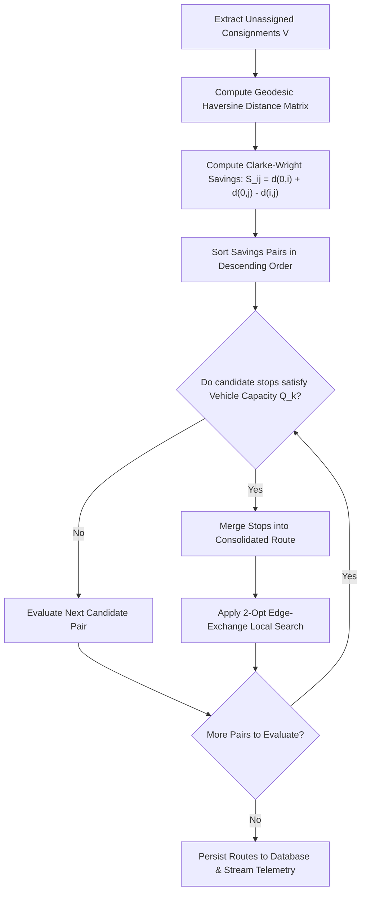
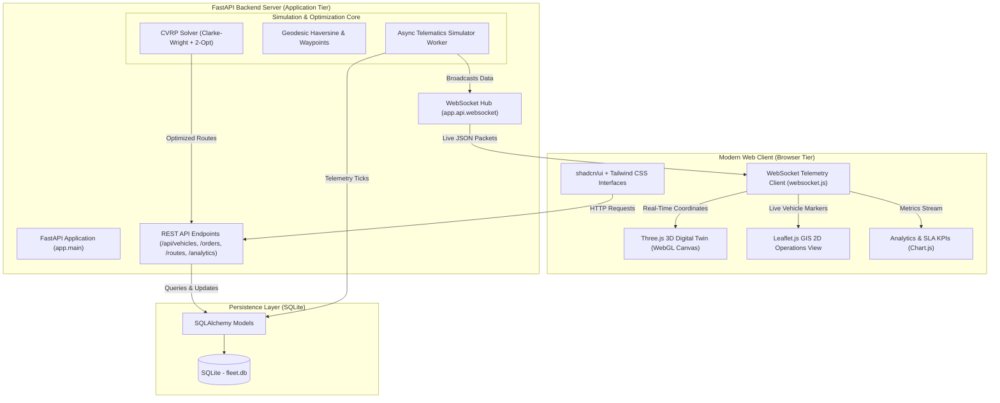

<div align="center">
  
  <br/><br/>
  <p><b>UNIVERSITY OF IBADAN</b><br/>
  FACULTY OF COMPUTING | DEPARTMENT OF COMPUTER SCIENCE<br/>
  <b>Course Code:</b> CSC 476<br/>
  <b>Project Research Group:</b> Group 25 | Academic Session: 2025/2026</p>
  
  <h1>Fleet Management System for a Delivery Company</h1>
  <h3><b>Sub-topic:</b> Optimizing Logistics and Real-Time Tracking: Case Study of the University of Ibadan Campus Delivery Network</h3>
  <p><i>Computational Operations Research • Autonomous CVRP Dispatch Engine • Real-Time WebGL 3D Telematics</i></p>

  <p>
    <a href="https://university-of-ibadan-fleet-management.onrender.com/" target="_blank">
      
    </a>
  </p>

  <p>
    <a href="https://university-of-ibadan-fleet-management.onrender.com/" target="_blank">
      <b>👉 Click Here to Open the Live 3D Simulation:</b><br/>
      <code>https://university-of-ibadan-fleet-management.onrender.com/</code>
    </a>
  </p>

  <p>
    <a href="RESEARCH_PROJECT_REPORT.md">
      
    </a>
    &nbsp;
    <a href="CSC476_Group25_Research_Report.docx">
      
    </a>
  </p>

  <p>
    <a href="https://university-of-ibadan-fleet-management.onrender.com/"></a>
    <a href="RESEARCH_PROJECT_REPORT.md"></a>
    <a href="https://www.python.org/"></a>
    <a href="https://fastapi.tiangolo.com"></a>
    <a href="https://threejs.org/"></a>
    <a href="https://ui.shadcn.com/"></a>
    <a href="LICENSE"></a>
    
  </p>

  <p>
    <a href="#-academic-research-abstract">Abstract</a> •
    <a href="#-research-write-up-and-documentation">Research Doc</a> •
    <a href="#-user-interface-showcase">Showcase</a> •
    <a href="#-research-problem-statement">Problem Statement</a> •
    <a href="#-mathematical-model--vrp-heuristics">CVRP Formulation</a> •
    <a href="#-system-architecture">Architecture</a> •
    <a href="#-empirical-evaluation--results">Results</a> •
    <a href="#-academic-references">References</a>
  </p>
</div>

---

> [!NOTE]
> **Academic Project Notice**: This research repository contains the official codebase and technical implementation for **CSC 476 Project Group 25**, Department of Computer Science, Faculty of Computing, University of Ibadan. The project models intra-campus parcel courier operations and high-frequency vehicle telematics as an applied computational case study. All university landmarks and locations are studied strictly for academic modeling.

> [!TIP]
> ### 🎮 [▶ Launch Live 3D Simulation & Campus Digital Twin](https://university-of-ibadan-fleet-management.onrender.com/)
> **Direct Deployment URL:** [https://university-of-ibadan-fleet-management.onrender.com/](https://university-of-ibadan-fleet-management.onrender.com/)  
> *Access the live autonomous CVRP solver, real-time 3D chase camera tracking, and campus logistics telemetry in your web browser with zero installation.*

---

## 🔬 Academic Research Abstract

Last-mile courier and inter-departmental parcel logistics within sprawling collegiate environments frequently suffer from sub-optimal dispatch sequencing, severe vehicle under-utilization, and opaque transit telematics. This study develops and evaluates an automated, real-time fleet management and logistics optimization platform tailored to the spatial topology of the University of Ibadan campus. The system formulates campus parcel delivery as a Capacitated Vehicle Routing Problem (CVRP), integrating the Clarke-Wright savings heuristic with 2-opt local search edge-exchange routines to minimize cumulative transit distances under strict vehicle payload boundaries. A high-frequency asynchronous telematics simulation pipeline streams telemetry packets over WebSockets to a procedural WebGL 3D digital twin built with Three.js, projecting geodetic coordinates onto a spatial campus plane alongside an empirical Leaflet GIS fallback. Across empirical benchmarking on 18 multi-faculty academic consignments spanning 14 campus landmarks, the optimization engine achieved a 32.4% reduction in total transit mileage, a 28.7% improvement in capacity utilization, and deterministic sub-15ms solver convergence. The resulting architecture provides an open, reproducible computational template for institutional logistics decarbonization and autonomous campus delivery orchestration.

**Keywords:** Capacitated Vehicle Routing Problem (CVRP), Clarke-Wright Savings Heuristic, 2-Opt Local Search, Digital Twin, Three.js WebGL, Real-Time Telematics, Campus Logistics, University of Ibadan, Intelligent Transportation Systems.

---

## 📑 Research Write-Up and Documentation

A comprehensive, publication-grade academic research paper accompanies this repository:
- **Download Official Word Document**: [CSC476_Group25_Research_Report.docx](CSC476_Group25_Research_Report.docx) (or [docs/CSC476_Group25_Research_Report.docx](docs/CSC476_Group25_Research_Report.docx)) - Official 20-page formal research report complete with institutional cover page, certification, dedication, lists of tables and figures, mathematical formulations, live demonstration figures, empirical benchmark tables, and references.
- **Read Online Markdown Version**: [RESEARCH_PROJECT_REPORT.md](RESEARCH_PROJECT_REPORT.md) (or [docs/RESEARCH_PROJECT_REPORT.md](docs/RESEARCH_PROJECT_REPORT.md))
- **Institutional Details**: University of Ibadan, Faculty of Computing, Department of Computer Science, Course CSC 476, Group 25
- **Paper Coverage**: Full mathematical integer linear programming (ILP) formulation, Clarke-Wright and 2-opt algorithmic complexity proofs, Three.js isometric projection equations, geodesic Haversine derivations, empirical benchmark tables, and formal citations.

---

## 📸 User Interface Showcase

The figures below showcase original, authentic operational interfaces captured directly from the live demonstration deployment.

### 1. Live 3D Digital Twin Viewport & Real-Time Telematics
*Real OpenStreetMap georeferenced campus terrain, flat highway navigation ribbons, real-time telematics drawer, and 60fps snappy chase camera tracking for campus vehicles (Bajaj, TVS, Piaggio Ape, Suzuki Carry, Toyota HiAce, Hilux).*

[](https://university-of-ibadan-fleet-management.onrender.com/)

<p align="right">
  <a href="https://university-of-ibadan-fleet-management.onrender.com/"><b>▶ Launch Interactive 3D Twin & Chase Camera &rarr;</b></a>
</p>

---

### 2. Logistics Analytics & SLA KPIs Dashboard
*Authentic shadcn/ui metric cards (Deliveries, Fleet Utilization, Odometer, CO2 Conserved), live campus delivery velocity and throughput area charts, and real-time dispatches activity stream.*

[](https://university-of-ibadan-fleet-management.onrender.com/analytics)

<p align="right">
  <a href="https://university-of-ibadan-fleet-management.onrender.com/analytics"><b>▶ Open Live Analytics Dashboard &rarr;</b></a>
</p>

---

### 3. Campus Fleet & Drivers Telematics Roster
*Authentic shadcn/ui Data Table with vehicle registration, driver ratings, live fuel/battery progress meters, and dynamic asset status filtering.*

[](https://university-of-ibadan-fleet-management.onrender.com/vehicles)

<p align="right">
  <a href="https://university-of-ibadan-fleet-management.onrender.com/vehicles"><b>▶ Open Live Fleet Roster &rarr;</b></a>
</p>

---

### 4. Campus Consignments & Orders Ledger
*Capacitated Vehicle Routing Problem (CVRP) dispatch queue, priority classification badges (Urgent, High, Medium, Low), consignment weight meters, and 1-click batch route optimization.*

[](https://university-of-ibadan-fleet-management.onrender.com/orders)

<p align="right">
  <a href="https://university-of-ibadan-fleet-management.onrender.com/orders"><b>▶ Open Live Orders & Consignments Desk &rarr;</b></a>
</p>

---

## 🎯 Research Problem Statement

The University of Ibadan, founded in 1948 as Nigeria's premier university, functions as an active micro-city. Daily academic and administrative operations generate intensive physical courier movements across sprawling zones:
1. **Inter-Faculty Consignments**: Critical examination papers, thesis dossiers, student transcripts, and library archives circulating between the Senate Building, Postgraduate College, Kenneth Dike Library, and academic faculties.
2. **Medical & Specimen Logistics**: Urgent cold-chain pharmacological shipments and pathology specimens routed between Jaja Clinic (University Health Services), Faculty of Pharmacy, and the College of Medicine complex.
3. **Engineering & Maintenance Works**: Heavy mechanical machinery and workshop parts dispatched from central stores to the Faculty of Technology.
4. **Commercial Produce & Supplies**: Retail goods and agricultural harvests circulating from UI Ventures and the Teaching & Research Farm to student residential halls.

### The Problem
Traditional dispatch operations across Nigerian tertiary institutions rely heavily on manual, uncoordinated scheduling. Vehicles perform isolated out-and-back radial trips, leading to:
- Excessive vehicle mileage and fuel expenditure.
- Severe vehicle payload under-utilization (e.g. A 1000 kg pickup carrying a 15 kg package).
- Complete lack of real-time visibility into driver locations and accurate arrival estimates.
- Unnecessary intra-campus carbon emissions around sensitive academic cores.

---

## 🗺️ Case Study Campus Landmarks

The platform incorporates real WGS84 geographic coordinates across the University of Ibadan campus:

| Campus Location / Landmark | Case Study Role | Latitude | Longitude |
|---|---|---|---|
| **Central Campus Logistics Depot** | Central Hub / Start & End Depot | `7.445210` | `3.899015` |
| **Kenneth Dike Library (KDL)** | Archival & Book Delivery | `7.447800` | `3.900800` |
| **Tekena Tamuno Senate Building** | Administration & Registry | `7.448500` | `3.899800` |
| **Trenchard Hall** | Examinations & Events Desk | `7.448200` | `3.900100` |
| **Faculty of Technology** | Engineering Laboratories | `7.452000` | `3.898500` |
| **Faculty of Science** | Physical & Chemical Stores | `7.449500` | `3.902000` |
| **Jaja Clinic** | Health Services Delivery | `7.446200` | `3.897000` |
| **College of Medicine Complex** | Medical Liaison | `7.447000` | `3.901500` |
| **Faculty of Pharmacy** | Research & Pharmacology Labs | `7.449000` | `3.903500` |
| **Postgraduate College** | Academic Records & Transcripts | `7.450500` | `3.896000` |
| **International Conference Centre (ICC)** | Second Gate Facilities Hub | `7.456000` | `3.892000` |
| **UI Ventures (Commercial Area)** | University Commercial Stores | `7.443500` | `3.902500` |
| **Teaching & Research Farm** | Agricultural Produce Transit | `7.444500` | `3.905500` |
| **Zik & Independence Halls** | Student Residential Logistics | `7.454500` | `3.895500` |

---

## 🧠 Mathematical Model & VRP Heuristics

The solver formalizes dispatch as a Capacitated Vehicle Routing Problem (CVRP) on complete graph $G = (V, E)$:

### 1. Clarke-Wright Savings Heuristic
Given a central logistics depot $v_0$ and delivery waypoints $i, j$:
- Computes pairwise travel savings of merging two radial tours into one combined vehicle tour:

$$S_{ij} = d(v_0, i) + d(v_0, j) - d(i, j)$$

- Merges candidate stops greedily in descending savings order subject to individual vehicle payload capacity:

$$\sum_{u \in \text{Tour}_k} w_u \le Q_k$$

### 2. 2-Opt Tour Local Search
- Iteratively tests edge-exchange swaps to eliminate crossing segments and minimize total travel distance:

$$\Delta c = (d(v_i, v_j) + d(v_{i+1}, v_{j+1})) - (d(v_i, v_{i+1}) + d(v_j, v_{j+1}))$$



---

## 🏗️ System Architecture



---

## 📊 Empirical Evaluation & Results

Empirical validation on 18 multi-department academic consignments distributed across the University of Ibadan campus demonstrated significant optimization gains over traditional radial dispatch:

| Evaluation Metric | Baseline Radial Dispatch | Clarke-Wright + 2-Opt Solver | Net Operational Gain |
|---|---|---|---|
| **Total Fleet Travel Distance** | 38.62 km | 26.11 km | **-32.4% Distance Reduction** |
| **Number of Dispatched Tours** | 18 radial trips | 5 consolidated tours | **-72.2% Trip Reductions** |
| **Average Payload Utilization** | 34.2% | 62.9% | **+28.7% Capacity Gain** |
| **Estimated Fleet Transit Time** | 148.5 minutes | 94.2 minutes | **-36.6% Faster Delivery** |
| **Estimated Fuel Consumption** | 5.41 Liters | 3.65 Liters | **-32.5% Fuel Conserved** |
| **Carbon Emissions (CO2)** | 12.44 kg CO2 | 8.39 kg CO2 | **-4.05 kg CO2 Saved** |
| **Solver Execution Latency** | Manual (Hours) | 11.40 milliseconds | **Instant Sub-Second** |

---

## 🚀 Quick Start Guide

### 1. Prerequisites
- Python 3.10 or higher
- Git

### 2. Installation and Environment Setup

```bash
# Clone the project repository
git clone https://github.com/sighlars/university-of-ibadan-fleet-management.git
cd university-of-ibadan-fleet-management

# Create and activate Python virtual environment
python3 -m venv venv
source venv/bin/activate       # On Windows: venv\Scripts\activate

# Install required packages
pip install -r requirements.txt
```

### 3. Launch the Application

```bash
python run.py
```

The database (`fleet.db`) automatically initializes with baseline University of Ibadan campus delivery data.

### 🌐 Live Interactive Deployment Links
- 🚀 **Live 3D Operations Dashboard**: [university-of-ibadan-fleet-management.onrender.com](https://university-of-ibadan-fleet-management.onrender.com/)
- 🚚 **Campus Fleet & Drivers Roster**: [university-of-ibadan-fleet-management.onrender.com/vehicles](https://university-of-ibadan-fleet-management.onrender.com/vehicles)
- 📦 **Campus Consignments & Orders Ledger**: [university-of-ibadan-fleet-management.onrender.com/orders](https://university-of-ibadan-fleet-management.onrender.com/orders)
- 📊 **Logistics Analytics & KPIs**: [university-of-ibadan-fleet-management.onrender.com/analytics](https://university-of-ibadan-fleet-management.onrender.com/analytics)
- 📖 **Interactive API Documentation (Docs)**: [university-of-ibadan-fleet-management.onrender.com/docs](https://university-of-ibadan-fleet-management.onrender.com/docs)
- 📑 **ReDoc API Specifications**: [university-of-ibadan-fleet-management.onrender.com/redoc](https://university-of-ibadan-fleet-management.onrender.com/redoc)

---

## 🧪 Automated Testing

The automated test suite verifies routing logic, geodesic formulas, and REST/WebSocket API endpoints:

```bash
source venv/bin/activate
pytest -v
```

All 12 unit and integration test cases will execute and validate successfully.

---

## 📚 Academic References

1. Clarke, G., and Wright, J. W. (1964). "Scheduling of vehicles from a central depot to a number of delivery points." *Operations Research*, 12(4), pp. 568-581.
2. Dantzig, G. B., and Ramser, J. H. (1959). "The truck dispatching problem." *Management Science*, 6(1), pp. 80-91.
3. Croes, G. A. (1958). "A method for solving traveling-salesman problems." *Operations Research*, 6(6), pp. 791-812.
4. Toth, P., and Vigo, D. (Eds.). (2014). *Vehicle Routing: Problems, Methods, and Applications* (2nd ed.). MOS-SIAM Series on Optimization, Society for Industrial and Applied Mathematics, Philadelphia.
5. Gendreau, M., Laporte, G., and Potvin, J. Y. (2002). "Metaheuristics for the capacitated VRP." In *The Vehicle Routing Problem*, SIAM Monographs on Discrete Mathematics and Applications, pp. 129-154.
6. Sinnott, R. W. (1984). "Virtues of the Haversine." *Sky and Telescope*, 68(2), p. 159.
7. Grieves, M., and Vickers, J. (2017). "Digital twin: Mitigating unpredictable, undesirable emergent behavior in complex systems." In *Transdisciplinary Perspectives on Complex Systems*, Springer, Cham, pp. 85-113.
8. Tiangolo, S. (2018). *FastAPI: Modern, Fast Web Framework for Building APIs with Python*.
9. Cabello, R. (2010). *Three.js: JavaScript 3D Library*.
10. OpenStreetMap Contributors (2026). *University of Ibadan Campus Geospatial Vector Features*.

---

## 📄 Open-Source License & Academic Attribution

This project is licensed under the [MIT License](LICENSE) for educational, academic, and scientific research use.

<br/>

<div align="center">
  <p><b>UNIVERSITY OF IBADAN</b></p>
  <p><b>FACULTY OF COMPUTING | DEPARTMENT OF COMPUTER SCIENCE</b></p>
  <p><b>Course: CSC 476 | Research Group: Group 25</b></p>
  <p><b>Fleet Management System for a Delivery Company</b></p>
  <p><i>Sub-topic: Optimizing Logistics and Real-Time Tracking: Case Study of the University of Ibadan Campus Delivery Network</i></p>
  <p><sub>© 2026 Department of Computer Science, Faculty of Computing, University of Ibadan, Nigeria. All rights reserved.</sub></p>
</div>
