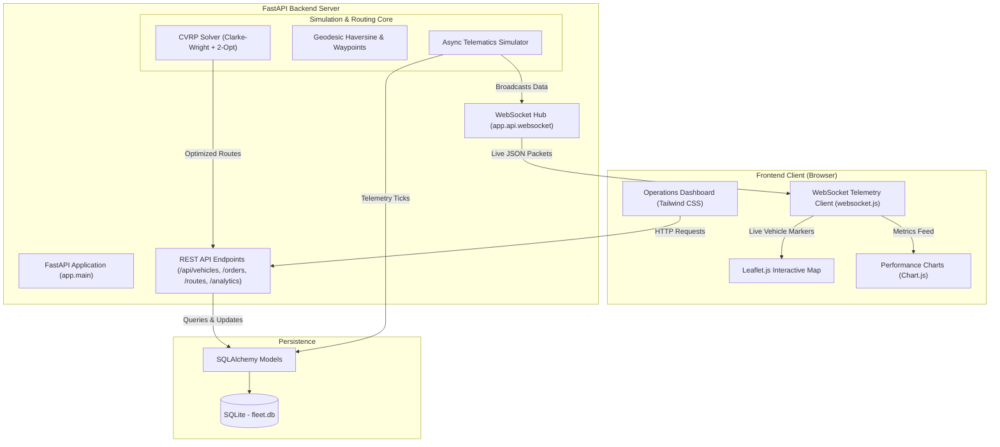

# 🚚 UI-FleetFlow — Campus Fleet & Logistics Management System

<div align="center">
  
  <br/>
  <h3><b>An Open-Source Logistics & Fleet Optimization Research Project</b></h3>
  <p><b>Academic Case Study: University of Ibadan (UI), Ibadan, Nigeria</b></p>
  <p><i>Real-time telematics, vehicle routing problem (CVRP) heuristics, and live campus dispatch.</i></p>
</div>

---

> [!IMPORTANT]
> **Academic Project Disclaimer**: This software is an independent student academic school project and open-source demonstration built for educational and research purposes. It is **not** an officially commissioned, endorsed, or affiliated platform of the University of Ibadan administration or any university directorate. All campus landmarks and facilities are referenced solely as an academic case study for urban/campus logistics modeling.

---

[](LICENSE)
[](https://www.python.org/)
[](https://fastapi.tiangolo.com)
[](https://www.sqlite.org/)
[](https://leafletjs.com/)
[]()

---

## 📌 Project Overview

**UI-FleetFlow** was developed as a school project exploring computational logistics and real-time telematics. It models multi-vehicle parcel distribution and shuttle routing across a university campus, using the **University of Ibadan (UI)**—Nigeria's premier university—as a practical real-world case study.

The platform addresses common university and institutional logistics scenarios:
1. **Inter-Faculty Consignments & Material Logistics**: Document, parcel, and examination logistics between academic departments, libraries, and administrative units.
2. **Medical & Laboratory Logistics**: Cold-chain specimen and supply routing connecting the University Health Services (Jaja Clinic), Faculty of Pharmacy, and the College of Medicine / UCH axis.
3. **Campus Facilities & Maintenance Fleet**: Dispatching utility pickups, trucks, and courier bikes with load and capacity constraints.
4. **Real-Time GPS Tracking**: Simulated high-frequency vehicle telemetry broadcast over WebSockets to an interactive Leaflet.js operations dashboard.

---

## 🗺️ Case Study Campus Landmarks

The simulation incorporates real geographic coordinates across the University of Ibadan campus to test routing heuristics against real distances:

| Campus Location / Landmark | Case Study Role | Latitude | Longitude |
|---|---|---|---|
| **Central Campus Logistics Depot** | Central Hub / Start & End Depot | `7.445210` | `3.899015` |
| **Kenneth Dike Library (KDL)** | Archival & Book Delivery | `7.447800` | `3.900800` |
| **Tekena Tamuno Senate Building** | Administration & Registry | `7.448500` | `3.899800` |
| **Trenchard Hall** | Examinations & Events Desk | `7.448200` | `3.900100` |
| **Faculty of Technology** | Engineering Laboratories | `7.452000` | `3.898500` |
| **Faculty of Science** | Physical & Chemical Stores | `7.449500` | `3.902000` |
| **Jaja Clinic** | Health Services Delivery | `7.446200` | `3.897000` |
| **College of Medicine Complex** | Medical Liaison | `7.447000` | `3.901500` |
| **Faculty of Pharmacy** | Research & Pharmacology Labs | `7.449000` | `3.903500` |
| **Postgraduate College** | Academic Records & Transcripts | `7.450500` | `3.896000` |
| **International Conference Centre (ICC)** | Second Gate Facilities Hub | `7.456000` | `3.892000` |
| **UI Ventures (Commercial Area)** | University Commercial Stores | `7.443500` | `3.902500` |
| **Teaching & Research Farm** | Agricultural Produce Transit | `7.444500` | `3.905500` |
| **Zik & Independence Halls** | Student Residential Logistics | `7.454500` | `3.895500` |

---

## 🧠 Logistics & Optimization Engine (VRP)

The solver models the **Capacitated Vehicle Routing Problem (CVRP)**:

### 1. Clarke-Wright Savings Heuristic
Given a central logistics depot $D$ and delivery points $i, j$:
- Combines separate round-trips into consolidated vehicle tours based on travel savings:
  
  $$S_{ij} = d(D, i) + d(D, j) - d(i, j)$$

- Merges stops sequentially while respecting each vehicle's maximum payload capacity:
  
  $$\sum_{i \in \text{Tour}_k} w_i \le Q_k$$

### 2. 2-Opt TSP Local Search
- Iteratively tests edge-exchange operations on each route to eliminate crossing segments and minimize total travel distance:
  
  $$\text{Route}' = R[1 \dots i-1] + R[i \dots j]^{-1} + R[j+1 \dots n]$$

---

## 🏗️ System Architecture



---

## 🚀 Quick Start Guide

### 1. Prerequisites
- Python 3.10+
- Git

### 2. Setup

```bash
# Clone the repository
git clone <YOUR_REPO_URL>
cd <YOUR_REPO_FOLDER>

# Create and activate a virtual environment
python3 -m venv venv
source venv/bin/activate       # On Windows: venv\Scripts\activate

# Install dependencies
pip install -r requirements.txt
```

### 3. Run the Application

```bash
python run.py
```

The database (`fleet.db`) will automatically initialize with sample case study data.

Open your browser to:
- **Operations Dashboard**: [http://localhost:8000](http://localhost:8000)
- **Fleet & Drivers Registry**: [http://localhost:8000/vehicles](http://localhost:8000/vehicles)
- **Logistics Dispatch Desk**: [http://localhost:8000/orders](http://localhost:8000/orders)
- **Analytics & SLA KPIs**: [http://localhost:8000/analytics](http://localhost:8000/analytics)
- **Interactive API Documentation (Swagger)**: [http://localhost:8000/docs](http://localhost:8000/docs)
- **ReDoc Specification**: [http://localhost:8000/redoc](http://localhost:8000/redoc)

---

## 🧪 Testing

The automated test suite validates routing optimization, geodesic formulas, and API endpoints:

```bash
source venv/bin/activate
pytest -v
```

All 12 unit and integration tests will execute.

---

## 📄 Open-Source License

This project is licensed under the [MIT License](LICENSE) — free and open for educational, academic, and research use.
