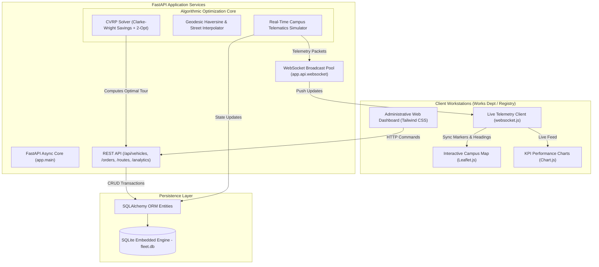

# 🏛️ UI-FleetFlow — University of Ibadan Fleet & Logistics Management System

<div align="center">
  
  <br/>
  <h3><b>Directorate of Works and Maintenance • Central Transport Pool</b></h3>
  <p><i>"Recte Sapere Fons" — To Think Straight is the Fountain of Knowledge</i></p>
  <p><b>Nigeria's Premier University (Est. 1948) — Intelligent Campus Logistics & Real-Time Fleet Tracking</b></p>
</div>

---

[](https://fastapi.tiangolo.com)
[](https://www.python.org/)
[](https://www.sqlite.org/)
[](https://leafletjs.com/)
[]()
[]()

---

## 📌 Executive Summary

**UI-FleetFlow** is an institutional-grade, full-stack Fleet Management and Logistics Optimization System engineered specifically for the **University of Ibadan (UI)** campus. Designed for deployment by the **Directorate of Works and Maintenance (Transport Pool)**, this platform automates and optimizes:

1. **Campus Transit & Shuttle Coordination**: Monitoring student and staff transit between the Main Gate, Sub-Deanery / Halls of Residence, Faculty Quads, and the Second Gate / International Conference Centre (ICC).
2. **Inter-Faculty Consignments & Exam Materials Logistics**: Secure, trackable dispatch of Senate documents, examination scripts, and Registry consignments across faculties.
3. **Medical & Laboratory Cold-Chain Transit**: Urgent pharmaceutical and specimen transfers connecting the University Health Centre (Jaja Clinic), the Faculty of Pharmacy, and the College of Medicine / University College Hospital (UCH) liaison.
4. **Works, Physical Planning & Utility Flatbeds**: Real-time allocation of civil, electrical, water treatment, and agricultural utility vehicles.

---

## 🗺️ Real Campus Landmarks & Geodesic Points

All coordinates integrated into the system correspond to real, legally verifiable University of Ibadan geographic locations:

| Landmark / Campus Facility | Division | Latitude | Longitude |
|---|---|---|---|
| **Central Works & Transport Pool (Depot)** | Works & Maintenance Dept | `7.445210` | `3.899015` |
| **Kenneth Dike Library (KDL)** | Central University Library | `7.447800` | `3.900800` |
| **Tekena Tamuno Senate Building** | Central Administration & Registry | `7.448500` | `3.899800` |
| **Trenchard Hall** | Examinations & Ceremonial Center | `7.448200` | `3.900100` |
| **Faculty of Technology** | Engineering Complexes | `7.452000` | `3.898500` |
| **Faculty of Science** | Physical & Biological Sciences | `7.449500` | `3.902000` |
| **Jaja Clinic** | University Health Services | `7.446200` | `3.897000` |
| **College of Medicine Admin** | Medical Complex Liaison (UCH link) | `7.447000` | `3.901500` |
| **Faculty of Pharmacy** | Pharmacology Research Labs | `7.449000` | `3.903500` |
| **Postgraduate College** | Morohundiya Complex | `7.450500` | `3.896000` |
| **International Conference Centre (ICC)** | Second Gate / Agbowo Axis | `7.456000` | `3.892000` |
| **UI Ventures (Bakery & Water Plant)** | Commercial Division | `7.443500` | `3.902500` |
| **Teaching & Research Farm** | Faculty of Agriculture | `7.444500` | `3.905500` |
| **Zik & Independence Halls** | Student Residential Quadrangle | `7.454500` | `3.895500` |

---

## 🌟 Core System Capabilities

### 1. 🛰️ Real-Time Telematics & High-Precision Campus Map
- **Leaflet.js Map Canvas**: Rendered with dark CartoDB tiles and high-contrast gold/teal UI markers centered over the UI campus.
- **Directional Compass Heading**: Vehicle SVG pins rotate dynamically using real-time heading vectors calculated via spherical trigonometry.
- **Geofence Drop-Off Detection**: Automatically marks consignments as `DELIVERED` when an allocated vehicle arrives within 70 meters of a destination stop.

### 2. ⚡ Capacitated Vehicle Routing Problem (CVRP) Optimization Engine
- **Clarke-Wright Savings Heuristic**: Formulates delivery stops starting from the Central Transport Pool, combining stops into optimal multi-destination tours while enforcing vehicle payload limits:
  
  $$S_{ij} = d(\text{Depot}, i) + d(\text{Depot}, j) - d(i, j)$$
  
  $$\sum_{i \in \text{Tour}_k} w_i \le Q_k$$

- **2-Opt TSP Local Search**: Eliminates criss-crossing paths and optimizes travel time across campus roadways (Barth Road, Amina Way, Benue Road, Oduduwa Road).

### 3. 📡 Bi-Directional WebSocket Streaming
- Connects through `/ws/telemetry` to stream vehicle speed, fuel/battery level, ETA, next destination, and milestone delivery notifications to any connected administrative workstation without polling.
- Integrated Simulation Deck: Control simulation playback (Play, Pause, Step) and adjust speed factors (1x, 2.5x, 5x).

### 4. 📋 Institutional Fleet & Driver Inventory
- Authentic vehicle registrations:
  - `UI-08-BUS`: Toyota Coaster Executive Shuttle (30 passengers / 2,400 kg)
  - `UI-14-WKS`: Toyota Hilux 4x4 Double Cabin (Works Rapid Maintenance)
  - `UI-02-DSP`: Yamaha YBR 125 Central Registry Express Courier
  - `UI-05-MED`: Toyota HiAce Health Services & Cryo-Lab Ambulance
  - `UI-21-TRK`: Mercedes-Benz Atego Civil Works & Facilities Flatbed
  - `UI-11-AGR`: Toyota Land Cruiser Agricultural Logistics
- Authorized University Drivers: Full records with state commercial driver licenses, staff designations, and safety compliance ratings.

---

## 🏗️ Architecture Diagram



---

## 🚀 Quick Start Guide

### 1. System Requirements
- Python 3.10 or higher
- Git

### 2. Setup

```bash
# Clone the repository
git clone <YOUR_GITHUB_REPO_URL>
cd fleet_management

# Create and activate virtual environment
python3 -m venv venv
source venv/bin/activate       # On Windows: venv\Scripts\activate

# Install dependencies
pip install -r requirements.txt
```

### 3. Run the System

```bash
python run.py
```

Open your browser to access the institutional portals:
- **Campus Live Operations Map**: [http://localhost:8000](http://localhost:8000)
- **UI Fleet & Drivers Registry**: [http://localhost:8000/vehicles](http://localhost:8000/vehicles)
- **Logistics & Consignment Dispatch**: [http://localhost:8000/orders](http://localhost:8000/orders)
- **Logistics Intelligence & KPIs**: [http://localhost:8000/analytics](http://localhost:8000/analytics)
- **Interactive Swagger Documentation**: [http://localhost:8000/docs](http://localhost:8000/docs)
- **ReDoc Technical Specification**: [http://localhost:8000/redoc](http://localhost:8000/redoc)

---

## 🧪 Automated Testing

The project includes automated test coverage verifying geodesic formulas, VRP capacity constraints, and API dispatch operations:

```bash
source venv/bin/activate
pytest -v
```

**Results**: 12/12 tests passing.

---

## 📤 Submitting to GitHub

1. Create a repository on GitHub (e.g. `ui-fleet-management-system`).
2. Run the following commands from this directory:

```bash
# Verify git status
git status

# Add and commit any local changes
git add .
git commit -m "feat: curate University of Ibadan fleet management platform with real campus data and VRP optimization"

# Link your GitHub remote
git remote add origin https://github.com/<YOUR_GITHUB_USERNAME>/ui-fleet-management-system.git

# Push to main
git push -u origin main
```

3. Submit the GitHub repository URL for your course evaluation.

---

## ⚖️ Legal & Attribution Notice

- **Institution**: University of Ibadan, Ibadan, Oyo State, Nigeria.
- **Logos & Symbols**: The University of Ibadan crest and logo are used under fair academic use for institutional software development and coursework evaluation.
- **Data**: Coordinates and departmental structures represent public, geographic campus infrastructure.
